<div align="center">

```text
█████╗ ██████╗ ███╗   ██╗ █████╗ ███╗   ██╗
██╔══██╗██╔══██╗████╗  ██║██╔══██╗████╗  ██║
███████║██║  ██║██╔██╗ ██║███████║██╔██╗ ██║
██╔══██║██║  ██║██║╚██╗██║██╔══██║██║╚██╗██║
██║  ██║██████╔╝██║ ╚████║██║  ██║██║ ╚████║
╚═╝  ╚═╝╚═════╝ ╚═╝  ╚═══╝╚═╝  ╚═╝╚═╝  ╚═══╝
```

### `BSc Computer Science Student`

[](https://git.io/typing-svg)

I explore technologies as I feel like it. Web apps, real-time tools, Python utilities, whatever I'm curious about next.

</div>

---

## `> skills`

<div align="center">


</div>

---

## `> git stats`

<div align="center">



*Keep the streak alive and the chicken grows. Break it and he's back to an egg.*

</div>

---

## `> explore`

<div align="center">

Take a look around. Everything I'm building lives in my repositories.

[](https://github.com/Adnan-Zhaikh?tab=repositories)

</div>

---

## `> connect`

<div align="center">

[](https://adnan-portfolio-olive-one.vercel.app/)
[](https://www.linkedin.com/in/adnan-shaikh-4763233b2)
[](https://leetcode.com/AdnanZhaikh)
[](mailto:adnanibrahimshaikh@gmail.com)

⭐ Thanks for stopping by!

</div>
